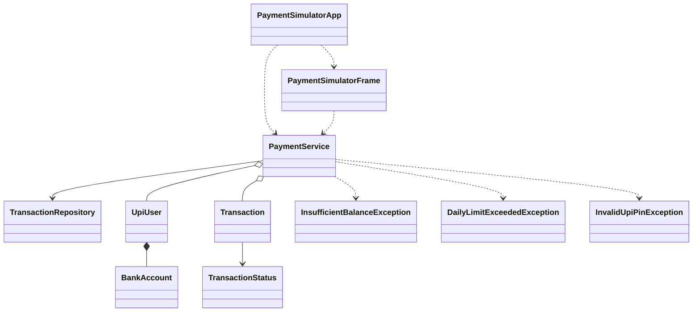

# UPI Payment Simulator

A Java Swing mini-project that simulates safe UPI transfers between users. It uses only the Java standard library.

## Run

Requires JDK 17 or newer. From the project folder, compile and launch in PowerShell:

```powershell
$sources = Get-ChildItem -Path src -Recurse -Filter *.java | ForEach-Object { $_.FullName }
javac -d out $sources
java -cp out com.upisimulator.PaymentSimulatorApp
```

Demo accounts: `alice@upi` with PIN `1234`, and `bob@upi` with PIN `5678`. Each starts with INR 10,000 and INR 7,500 respectively, with a daily transfer limit of INR 5,000. Three incorrect PIN attempts lock transfers for that account until the app restarts. Use **Add user** to create more accounts.

The transaction ledger is stored at `data/transactions.csv`. Accounts are sample in-memory data and are reset when the app restarts.

## Features

- Sender balance and daily-limit validation before any money moves.
- Synchronized transfers, preventing concurrent requests from overspending an account.
- Failed attempts recorded with their reason; successful transfers debit and credit as one service operation.
- PINs are salted and hashed in memory; PIN entry is cleared after each attempt.
- Transaction history persists between runs; mini statements can be filtered by account.
- Custom exceptions for insufficient balance, exceeded daily limit, and invalid or locked PINs.

## Package diagram



Packages: `com.upisimulator.model`, `com.upisimulator.service`, `com.upisimulator.persistence`, `com.upisimulator.exception`, and `com.upisimulator.ui`.
